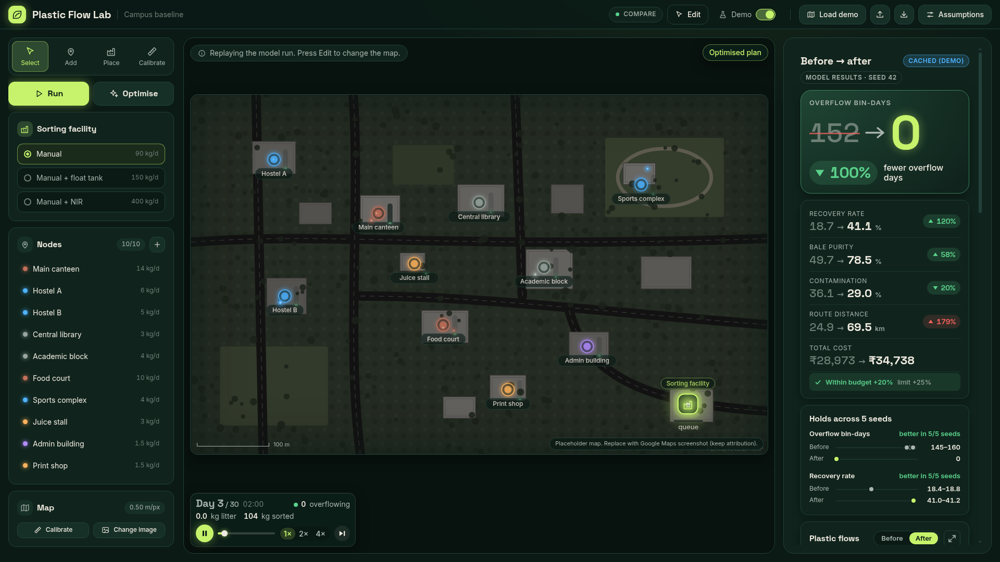
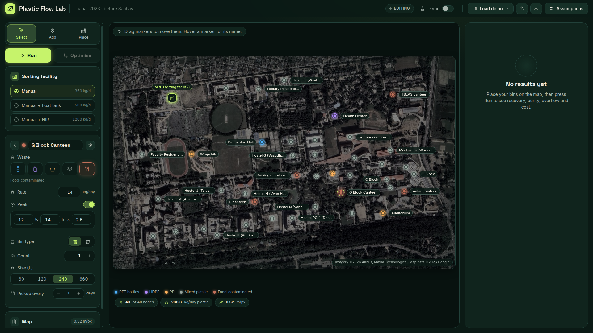
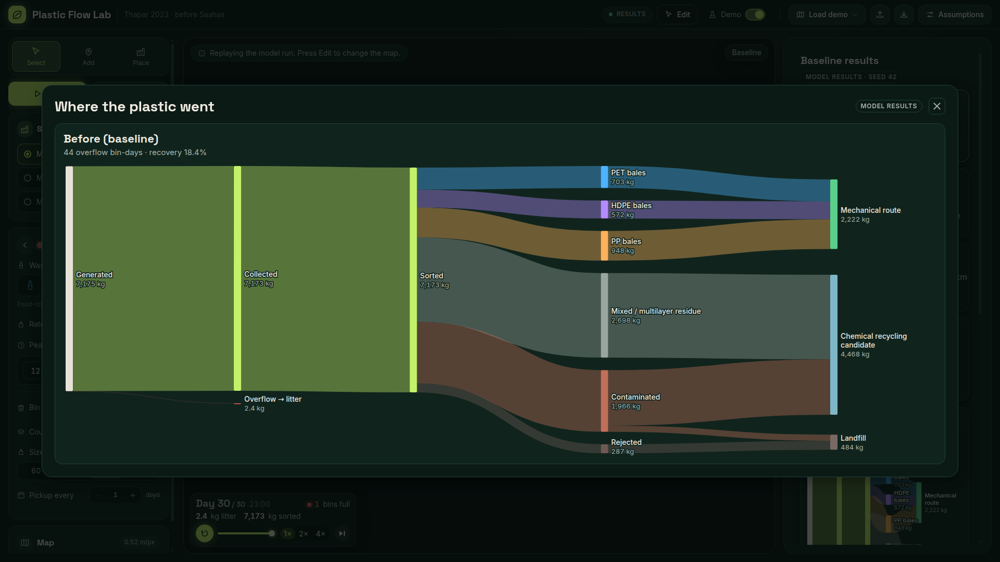
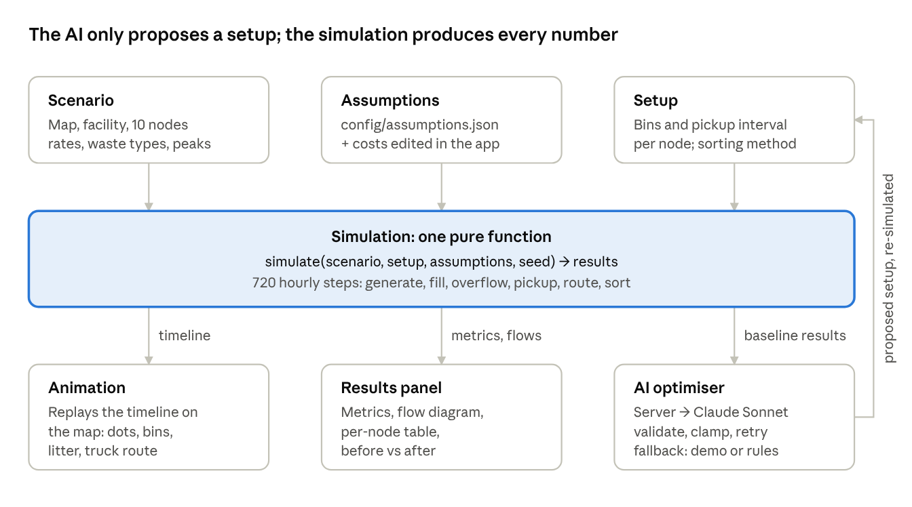

# Plastic Flow Lab

**An AI-assisted simulator for a campus plastic-waste collection and sorting system.** The AI proposes a better setup; the simulation verifies it.

Made for the college assignment *"Plastic Waste Management: From Collection to Recycling"* (bullet 2: set up a collection and sorting system).

> **How this was made.** This is my first project built in Claude Code. The code is written by [Claude Code](https://claude.com/claude-code), not by hand. It used several coding sub-agents, and it also did the web and document research behind the numbers and wrote the docs.
>
> **My part:**
> - **Direction and decisions.** I wrote the brief and made the design calls, often choosing between options the AI proposed. Examples: modelling the real Thapar campus with up to 40 points, turning the before/after-Saahas idea into two demo campuses, counting bale revenue and putting the budget on *net* cost, and letting users cancel an AI request.
> - **Real-world input.** I sourced Thapar's waste-management documents, the official campus map, the MRF's location, and Google Maps captures that identify the hostels and blocks.
> - **Testing.** I used the app hands-on and found many of the bugs fixed along the way: implausible map calibrations, clipped labels, an unstyled panel, stacking undo messages, a missing cancel and a missing rename.
> - **Team coordination.** I'm organising the field data collection and the video.
>
> So read it as an AI-built tool shaped and checked by me, not as a sample of my own hand-written code.



## What it does

1. **Map your campus.** Place up to 40 waste-generating nodes (hostels, canteens, academic blocks, library...) and a sorting facility on a map image. The demo uses the real Thapar Institute (TIET), Patiala campus: 40 real buildings and the real MRF.
2. **Describe today's setup.** For each node set the waste type, kg/day, rush hours, bins (type, count, size) and pickup interval; pick the facility's sorting method.
3. **Run 30 days.** An hourly simulation plays back in about 30 seconds: bins fill, overflow and leak litter, trucks drive the shortest route, and the facility sorts plastic into bales.
4. **See where every kilogram went.** Metrics (recovery, purity, contamination, overflow, distance, spend, bale revenue, net cost, CO₂e avoided), a flow diagram from generation to recycling route, and a per-node table.
5. **Optimise with AI.** Claude Sonnet proposes new pickup intervals, bin types and sizes and a sorting method, with a reason for each. The **same simulation re-runs** the proposal and shows before vs after, checked across 5 random seeds and against a net-cost budget.

**Two demo campuses** (top bar, Load demo): *Thapar 2023 · before Saahas* (one unlabelled mixed bin per point) and *Thapar 2024 · after Saahas* (same capacity and schedule, labelled segregated bins, as Thapar did with Saahas Zero Waste). The cached AI answer is a real Claude Sonnet 5.5 answer for the 2023 campus.

30 days, seed 42. *All numbers are model results from our assumptions (24 of 34 are still marked as estimates), not measurements.*

| | Before Saahas (2023) | After Saahas (real, 2024) | AI plan (Claude) |
|---|---|---|---|
| Bins segregated | 0 of 40 | 40 of 40 | 35 of 40 |
| Overflow bin-days | 44 | 44 | 0 |
| Recovery rate | 18.4% | 26.1% | 28.0% |
| Bale purity | 59.5% | 71.1% | 82.5% |
| Plastic recycled | 1,322 kg | 1,875 kg | 2,010 kg |
| CO₂e avoided | 1.25 t | 1.77 t | 1.90 t |
| Sent to landfill | 484 kg | 391 kg | 494 kg |
| Spend | ₹47.0k | ₹47.7k | ₹57.0k |
| Bale revenue | ₹51.6k | ₹73.1k | ₹78.5k |
| Net | ₹4.5k surplus | ₹25.4k surplus | ₹21.4k surplus |

Reading it honestly: given the 2023 campus, the AI independently proposed nearly what Thapar actually did with Saahas (segregation at 35 of the 40 points). It went further on overflow, recovery and CO₂e by right-sizing bins and adding a float-tank sorter. Saahas's real plan ends with a slightly larger surplus and less landfill, because it segregates everywhere without any extra sorting cost. The AI's float-tank sorter loses a little more in processing, so its landfill is about the same as before (494 vs 484 kg). So the AI matches the real decision and beats it on some measures, not all. Both numbers come from our model with estimated inputs, not from measurements.

| Map editor | Where the plastic goes |
|---|---|
|  |  |

## Quick start

**No terminal experience?** Follow **[GETTING-STARTED.md](GETTING-STARTED.md)**: install Node.js, then double-click `start-windows.bat` (Windows) or `start-mac.command` (Mac). It also explains how to open the app on an Android phone or iPhone over Wi-Fi.

**Developers** (Node.js 20+):

```bash
npm install
npm run dev      # http://localhost:5173 (dev server with the AI endpoint)
npm start        # build + production server at http://localhost:8787
npm test         # 50 automated tests
```

**Demo path (3 minutes):** Load **"before"** (Thapar 2023) → switch **Demo** on → **Run** → **Optimise** → compare before/after. Then load **"after"** (Thapar 2024) → **Run** to show what Thapar really did.

### Demo mode vs live AI

- **Demo on:** replays a real saved Claude answer for the demo campus (`public/demo/cached-proposal.json`, made for the 2023 campus). No internet or login needed. If the scenario has been edited, it falls back to the built-in rule-based plan.
- **Demo off:** calls Claude Sonnet through the server. By default it uses a logged-in [Claude Code](https://claude.com/claude-code) subscription (`claude -p`). To use an API key instead, set `"provider": "anthropic-api"` in `config/llm.json` and put `ANTHROPIC_API_KEY` in `.env` (see `.env.example`). The key never reaches the browser.
- If the AI fails or returns an invalid answer twice, the app uses a labelled rule-based fallback, so Optimise always works.

## Documentation

| Document | For |
|---|---|
| [GETTING-STARTED.md](GETTING-STARTED.md) | Running and checking the app with no terminal; phones and tablets |
| [docs/TEAM-GUIDE.md](docs/TEAM-GUIDE.md) | Full explanation: how everything works, results, AI, code map, testing, limitations, **viva Q&A**, glossary |
| [docs/HOW-IT-WORKS.md](docs/HOW-IT-WORKS.md) | Short plain-words explainer of the simulation |
| [data/README.md](data/README.md) | How to fill in the field-survey CSV |
| [public/maps/README.md](public/maps/README.md) | The real campus map, how it was captured and how to replace it |
| [docs/FIELD-DATA-GUIDE.md](docs/FIELD-DATA-GUIDE.md) | What the team should collect on campus next |
| [plan.md](plan.md) | Technical design: data contracts, units, rules, task breakdown |
| [project-brief.md](project-brief.md) | The original brief |

## How it works (short)



- **The simulation is a pure function:** `simulate(scenario, setup, assumptions, seed) → results`. It runs 720 hourly steps and covers generation with rush hours, bin fill and overflow (20% litter, 80% picked up later as contaminated), and end-of-day pickups (interval *k*: day *d* when `(d+1) mod k = 0`). It also plans the shortest truck routes, sorts plastic with throughput, accuracy and contaminant detection by method, and prices the result: spend, bale revenue and net cost. Same inputs always give identical results.
- **The animation only replays** the simulation's timeline; it never computes outcomes.
- **The AI only proposes settings.** Its answer is validated, out-of-range values are clamped, invalid JSON is retried once, and it falls back to a rule-based plan. The prompt requires the smallest bin that works, net cost within budget (net may rise by at most 25% of baseline spend; it is told the bale prices), and reasons that cite input numbers, never predicted results.
- **All model numbers live in `config/assumptions.json`**, each with a unit, a source and an estimate flag. Costs can be edited in the app's Assumptions panel and are saved with the scenario.

## Project structure

```
config/        assumptions.json (every model number), ui.json (colours, labels), llm.json (AI provider/model)
src/sim/       the simulation engine + tests
src/llm/       browser-side AI client, answer validation, rule-based fallback, demo fingerprint
server/        Node server: /api/optimise, system prompt, Claude providers, CLI tool
src/app/       app shell, store, map editor, controls, import/export
src/anim/      canvas animation that replays the timeline
src/results/   metrics, flow diagram, per-node table, before/after, AI activity
src/assumptions/  Assumptions panel (editable costs)
src/styles/    design tokens and shared styles
public/        demo scenarios (before/after Saahas), cached AI answer, campus map images
data/          field-survey CSV template
docs/          team guide, explainer, images
fixtures/      fake test data used by component test pages
```

## Plugging in real data

These drop in with **no code changes**:

- **Field data:** see [docs/FIELD-DATA-GUIDE.md](docs/FIELD-DATA-GUIDE.md) for what to collect. Fill `data/nodes.template.csv`, then use **Import → CSV** in the app and click each node's spot on the map.
- **A different map:** follow `public/maps/README.md`, or use **Change image** + **Calibrate** in the app. (The Thapar map is already in place.)
- **Sourced assumptions:** edit values and sources in `config/assumptions.json` and set `"estimate": false`. Most are already sourced from the Thapar case study, CPCB, US EPA WARM, IndiaMART and Punjab minimum wage; the rest keep the amber "estimate" tag with their reasoning shown in the Assumptions panel.

After changing the demo scenario, regenerate the cached AI answer with `node server/cli-optimise.mjs <scenario.json> <baseline-results.json>`.

The Thapar source documents are the case study *"From theory to practice"* and *"Waste Management at Thapar Institute"*. They live in a local `pdfs/` folder that is not committed.

## Tests

`npm test` runs 54 tests: hand-calculated simulation cases (overflow days, pickup timing, backlog, sorting, cost, routing), mass balance (every kg accounted for), determinism, AI answer clamping, retry and fallback, demo replay and fingerprint, and app, animation and results checks. An independent rebuild of the simulation matched every number.

## Built with

Vanilla JavaScript + [Vite](https://vitejs.dev), Canvas 2D and SVG, [d3-sankey](https://github.com/d3/d3-sankey), Node.js, and Claude Sonnet 5.5. The code was written by [Claude Code](https://claude.com/claude-code) (an AI coding agent) from our brief and decisions; see "How this was made" above and the Team Guide, section 9.
